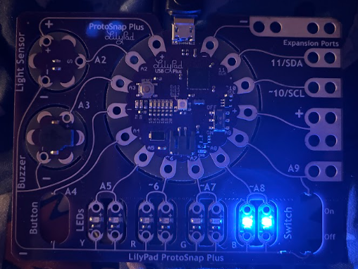

Every second, a random PWM pin will turn on at a random brightness, remain on for the second, then turn off.

A tip I would give myself would be to not overcomplicate things by overdefining variables, i.e. the 1 delay.

