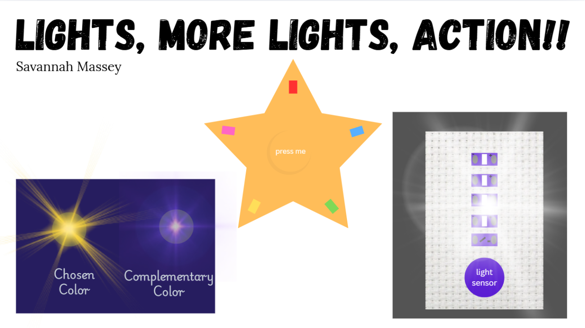
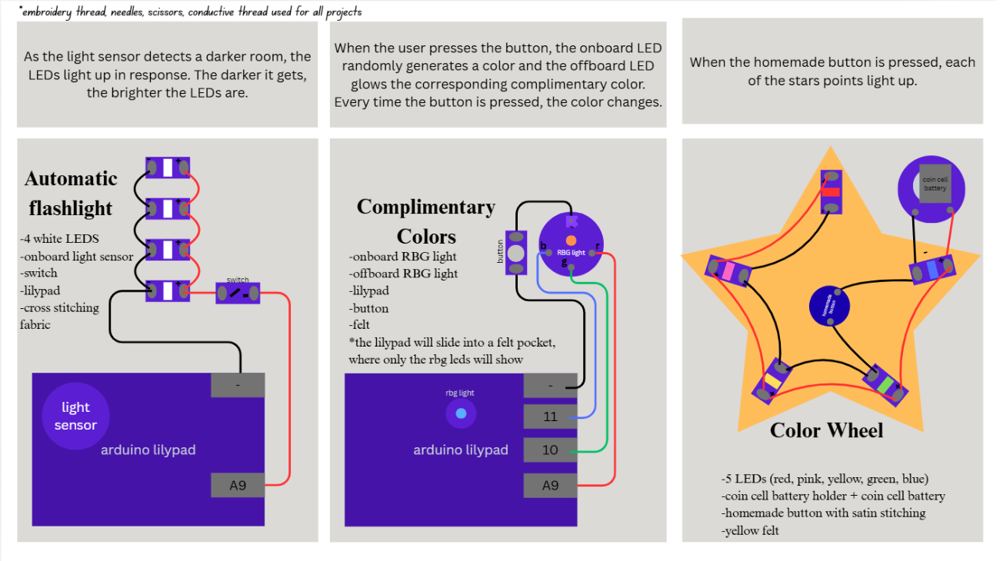

1. As the light sensor detects a darker room, the LEDs light up in response. The darker it gets, the brighter the LEDs are.

2. When the user presses the button, the onboard LED randomly generates a color and the offboard LED glows the corresponding complimentary color. Every time the button is pressed, the color changes.

3. When the homemade button is pressed, each of the stars points light up.

