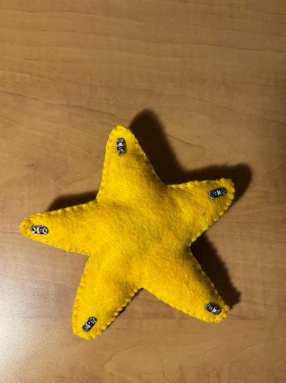
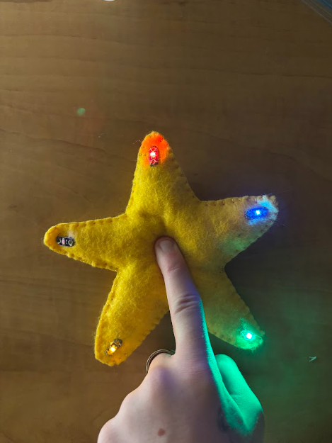
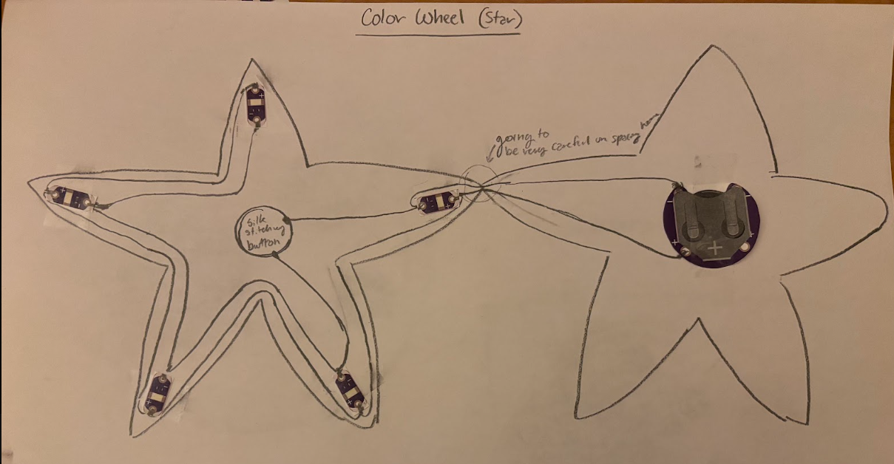

#Lights, More Lights, Action! presents the Color Wheel:
5 LEDs ordered in the color spectrum sewn onto a plush felt star. The motivatoon behind this was to hve a simple working piece that looks polished.

| Off | On |
| --- | --- |
|  | |
*all lights are on, the room is just a bit too bright to show well on camera

Materials:
- felt
- embroidery thread
- conductive thread
- scissors
- 5 different colored LEDs
- coin cell battery 
- coin cell battery holder

| Revised Color Wheel Paper Prototype |
| --- |
|  |

| Color Wheel Physical Prototype |
| --- |
|  |

Tips
- If making a plush, cut up the extra felt from the original piece to use as stuffing.
- Reuse past material! For this, I just used the homemade switch I had from the bracelet project.

 
